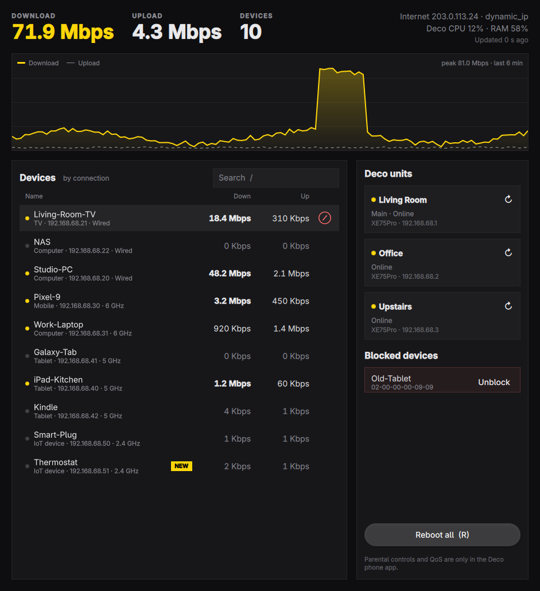

# Deco Monitor



Watch a TP-Link Deco mesh from an Omarchy desktop: total and per-device live
speeds, every connected device, the Deco units and their internet status, and
alerts when a new device joins. It can block and unblock devices (the same
blocked list as the phone app's Block button) and reboot Deco units.

It talks to the Deco's own local web API (the one behind http://192.168.68.1),
the same API Home Assistant's Deco integration uses. Blocking goes through the
phone app's own local protocol (TMP over SSH on port 20001), with the opcodes
and parameters taken from the Deco Android app 3.10.666: block 0x4017,
blocked list 0x4018, unblock 0x4019. Parental controls and QoS stay in the
phone app.

## Pieces

| Piece | What it is |
|---|---|
| `deco` | Python CLI: logs in (RSA + AES, like the Deco web page), prints JSON. `deco watch` polls forever. |
| `deco-monitor.service` | systemd user service running `deco watch 3`; writes `$XDG_RUNTIME_DIR/deco-monitor/status.json` and sends a notification for new devices. |
| `decomon` | Qt Quick app reading that file. |
| bar widget | [omarchy-deco-monitor](https://github.com/hell0world69/omarchy-deco-monitor), an Omarchy shell plugin that also reads that file. |

Only the service logs in: the Deco allows one local session at a time, so the
app and the widget never fight over it.

## Setup

Needs an Omarchy (Arch) system and a Deco in router mode at `192.168.68.1`.
Tested with three XE75 Pro units on firmware 1.5.0.

```sh
git clone https://github.com/hell0world69/deco-monitor.git ~/Work/deco-monitor
cd ~/Work/deco-monitor
# The Deco owner password (your TP-Link ID password), kept in the GNOME keyring
secret-tool store --label='Deco router' service deco-monitor
# The TP-Link ID email (needed for blocking; the SSH user is its SHA-1)
secret-tool store --label='Deco TP-Link ID email' service deco-monitor-email

bin/install                                   # builds and installs the package (asks for sudo)
systemctl --user enable --now deco-monitor    # start polling
```

`DECO_HOST` overrides the Deco address (default `192.168.68.1`).

The Deco locks SSH logins for two hours after ten failures, so after one failed
TMP login `deco` refuses to try again for two hours.

## Commands

```
deco status | clients | nodes | wan     JSON snapshots
deco reboot [MAC...]                    reboot all Deco units, or the given ones
deco blocked | block MAC | unblock MAC  the blocked list (block refuses this computer)
deco raw 'admin/device?form=device_list' '{"operation":"read"}'
```

Speeds from the Deco are kilobits per second.

## Keyboard (decomon)

| Key | Action |
|---|---|
| `/` or `Ctrl+F` | Search devices |
| `Space` | Show or hide idle devices |
| `S` | Sort by connection (Wired, 6 GHz, 5 GHz, 2.4 GHz; the default), name, or speed |
| `↑` `↓` | Move through devices |
| `B` | Block the selected device (asks first) |
| `Menu` or `Shift+F10` | Device menu: Block, Unblock, copy IP or MAC (also right-click) |
| `R` | Reboot all Deco units (asks first) |
| `Esc` | Clear search, close dialogs |
| `?` | Show shortcuts |
| `Q` | Quit |

## Development

`bin/build`, `bin/test`, `bin/install`.

## License

MIT. Unofficial and not affiliated with TP-Link. The TMP framing follows
[pydeco-tmp](https://github.com/mthsg/pydeco-tmp) (MIT).
